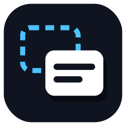
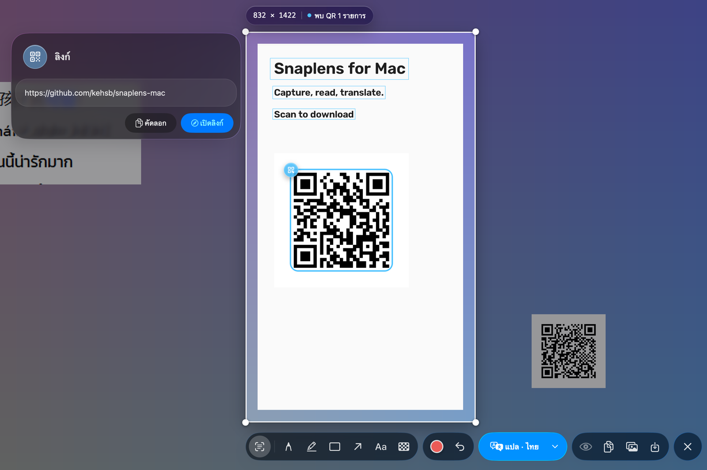
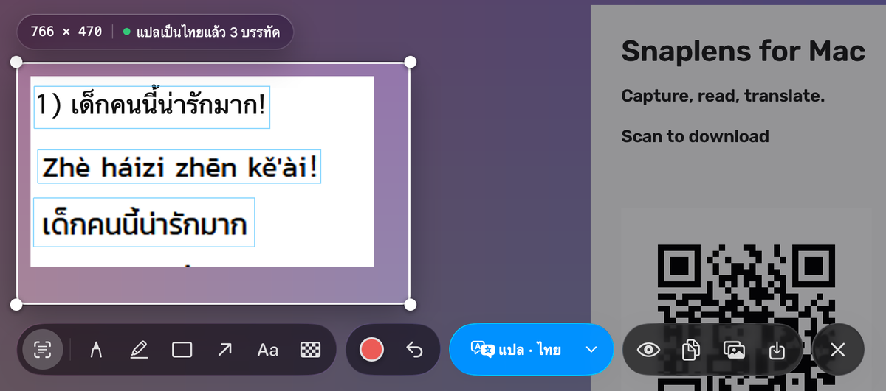
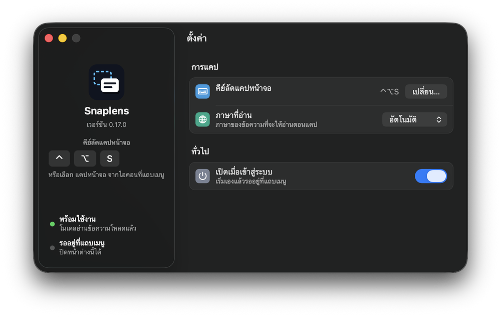

[English](README.md) | **ภาษาไทย**

<p align="center">
  
</p>

<h1 align="center">Snaplens</h1>

<p align="center">
  <b>แคปหน้าจอเฉพาะส่วนที่ต้องการ ให้แอปอ่านข้อความ แล้วดูคำแปลวางทับตรงที่ข้อความเดิมอยู่</b>
  <br>
  แอปบนแถบเมนูของ macOS สำหรับแคปหน้าจอ อ่านข้อความภาษาจีน อังกฤษ และไทยได้ในเครื่อง แปลทับตำแหน่งเดิม
  วาดและเขียนบนภาพแคปได้ และบอกว่า QR ในภาพมีข้อมูลอะไร
</p>

<p align="center">
  <a href="https://github.com/kehsb/snaplens-mac/releases/latest"></a>
  
  
  
  <a href="LICENSE"></a>
</p>

<p align="center">
  <a href="https://github.com/kehsb/snaplens-mac/releases/download/v0.17.0/Snaplens-0.17.0.dmg"></a>
  <br>
  <sub>Snaplens-0.17.0.dmg · ประมาณ 170 MB · macOS 26 Tahoe · Apple Silicon ·
  <a href="https://github.com/kehsb/snaplens-mac/releases/latest">เวอร์ชันล่าสุด</a> ·
  <a href="#ติดตั้ง">วิธีติดตั้ง</a></sub>
</p>

<p align="center">
  <a href="#ฟีเจอร์">ฟีเจอร์</a> ·
  <a href="#ติดตั้ง">ติดตั้ง</a> ·
  <a href="#วิธีใช้">วิธีใช้</a> ·
  <a href="#คีย์ลัดและเมาส์">คีย์ลัด</a> ·
  <a href="#ความเป็นส่วนตัวและสิทธิ์">ความเป็นส่วนตัว</a> ·
  <a href="#คำถามที่พบบ่อยและการแก้ปัญหา">คำถามที่พบบ่อย</a> ·
  <a href="#บิลด์จากซอร์สโค้ด">บิลด์จากซอร์สโค้ด</a>
</p>

> [!NOTE]
> **Snaplens ใช้ภาษาไทยทั้งแอป** ชื่อปุ่มและเมนูของแอปในเอกสารนี้สะกดตรงกับที่เห็นบนจอทุกคำ ส่วนเมนูของ macOS และ GitHub เขียนตามชื่อภาษาอังกฤษ ถ้าเครื่องตั้งเป็นภาษาไทยจะเห็นเป็นชื่อไทยแทน เช่น System Settings คือ การตั้งค่าระบบ และ Privacy & Security คือ ความเป็นส่วนตัวและความปลอดภัย

<p align="center">
  
  <br>
  <sub>อ่าน QR code ในพื้นที่ที่เลือก: การ์ดบอกว่า QR เขียนว่าอะไร และเปิดลิงก์ได้ทันที ภาพหน้าจอทั้งหมดใช้ข้อมูลจำลอง</sub>
</p>

## ฟีเจอร์

- **แปลทับที่เดิม** คำแปลแต่ละบรรทัดวาดทับข้อความต้นฉบับบนกล่องที่ระบายสีให้กลืนกับพื้นหลัง เลย์เอาต์จึงไม่เพี้ยน แปลเป็นไทย (ค่าเริ่มต้น) อังกฤษ จีนตัวย่อ จีนตัวเต็ม ญี่ปุ่น เกาหลี หรือเวียดนามก็ได้
- **OCR ในเครื่อง** อ่านภาษาจีน อังกฤษ และไทยในเครื่องด้วย [RapidOCR](https://github.com/RapidAI/RapidOCR) ซึ่งรันโมเดล PaddleOCR (PP-OCR) บน ONNX Runtime ภาพหน้าจอไม่ถูกอัปโหลดไปไหน
- **ทุกจอด้วยคีย์ลัดเดียว** กด **⌃⌥S** แล้วทุกจอจะหยุดนิ่งที่ความละเอียด Retina เต็ม ทับทั้งแถบเมนูและ Dock ใช้ได้ทุก Space และทับแอปที่เปิดเต็มจอได้ด้วย
- **เลือกช่องแบบ Snipaste** Snaplens หากล่องจากพิกเซลในภาพเอง ชี้เมาส์แล้วคลิกเพื่อเลือก หมุนล้อเมาส์เพื่อขยายออกไปยังช่องที่ใหญ่กว่า หรือจะลากเลือกพื้นที่เองก็ได้ มีแว่นขยาย 8× บอกพิกัดพิกเซลและสี
- **วาดและเขียนบนภาพ** ปากกา ปากกาเน้นข้อความ สี่เหลี่ยม ลูกศร ข้อความ และโมเสก มี 5 สี 4 ขนาด และเลิกทำได้ คัดลอกผลลัพธ์ (**⌘C**) หรือบันทึกเป็น PNG หรือ JPEG (**⌘S**)
- **QR** ถอดรหัส QR ทุกตัวในพื้นที่ที่เลือกและตีกรอบให้ การ์ดข้างพื้นที่ที่เลือกจะบอกว่าแต่ละตัวมีข้อมูลอะไร ไม่ว่าจะเป็นลิงก์ ข้อความ พร้อมเพย์ Thai QR จ่ายบิล QR ร้านค้ามาตรฐาน EMVCo หรือมินิ QR บนสลิปธนาคารและสลิป TrueMoney คัดลอกสิ่งที่การ์ดแสดงได้ หรือเปิดลิงก์เว็บในเบราว์เซอร์ก็ได้ ถ้า QR ชำระเงินหรือ QR บนสลิปไม่ผ่านการตรวจ CRC จะมีคำเตือน
- **หน้าตาแบบ macOS แท้ๆ** แถบเครื่องมือตอนแคปเป็น Liquid Glass หน้าต่างตั้งค่าหน้าตาแบบ System Settings แจ้งเตือนผ่าน Notification Center และไม่มีไอคอนบน Dock คีย์ลัดใช้ Carbon จึงไม่ต้องขอสิทธิ์ Accessibility หรือ Input Monitoring
- **ไม่มี telemetry** ไม่เก็บสถิติการใช้งาน ไม่ส่งรายงานแครช และไม่เช็กอัปเดต

ถ้ากำลังหาฟีเจอร์ตรวจสลิป ตอนนี้การตรวจสลิปโอนเงินของธนาคารไทยด้วย Thunder API ไม่ได้อยู่ใน Snaplens แล้ว แต่ย้ายไปอยู่ที่แบรนช์ [`ThunderAPI`](https://github.com/kehsb/snaplens-mac/tree/ThunderAPI) โดยบิลด์สุดท้ายของเวอร์ชันนั้นคือ [Snaplens 0.16.0](https://github.com/kehsb/snaplens-mac/releases/tag/v0.16.0)

## ติดตั้ง

### ความต้องการของระบบ

| | แอปสำเร็จรูป (DMG) | จากซอร์สโค้ด |
|---|---|---|
| **Mac** | Apple Silicon (arm64) เท่านั้น | Apple Silicon (wheel ที่ล็อกเวอร์ชันไว้เป็น arm64) |
| **macOS** | **macOS 26 Tahoe** (ทดสอบบน 26.7.1) | 14 ขึ้นไปตามแท็กของ wheel (Qt bindings ของ PySide6 สร้างสำหรับ 15 ขึ้นไป) แต่ทดสอบแล้วเฉพาะ 26 |
| **Python** | มากับแอปแล้ว | 3.13 (`brew install python@3.13`) |
| **พื้นที่ดิสก์** | ไฟล์ดาวน์โหลดประมาณ 170 MB ติดตั้งแล้วประมาณ 365 MB | |
| **อินเทอร์เน็ต** | ใช้ตอนแปล | เหมือนกัน และต้องดาวน์โหลดโมเดล OCR ครั้งแรกครั้งเดียว (ประมาณ 56 MB) |

> [!NOTE]
> `Info.plist` ของแอปประกาศว่ารองรับ macOS 12 แต่ Python และไลบรารีที่มากับแอปบิลด์มาสำหรับ macOS 26
> **ไฟล์ DMG จึงใช้กับ macOS ที่เก่ากว่า 26 ไม่ได้**

### ดาวน์โหลด

| | |
|---|---|
| **เวอร์ชันล่าสุด** | <https://github.com/kehsb/snaplens-mac/releases/latest> |
| **Snaplens 0.17.0** | [Snaplens-0.17.0.dmg](https://github.com/kehsb/snaplens-mac/releases/download/v0.17.0/Snaplens-0.17.0.dmg) (ประมาณ 170 MB, Apple Silicon) |
| **SHA-256** | `b24f2f70cffd7699156f0404a1bd94a8bb1aec0792ee241b969a3810d2391358` |

ตรวจสอบไฟล์ที่ดาวน์โหลดมา:

```bash
shasum -a 256 ~/Downloads/Snaplens-0.17.0.dmg
# b24f2f70cffd7699156f0404a1bd94a8bb1aec0792ee241b969a3810d2391358
```

### เปิดใช้ครั้งแรก

1. เปิดไฟล์ DMG แล้วลาก **Snaplens** ไปวางที่ **Applications**
2. เปิด Snaplens ครั้งแรก macOS จะบล็อกไว้เพราะแอปยังไม่ผ่าน notarization ให้เปิด **System Settings > Privacy & Security** เลื่อนลงไปแล้วกด **Open Anyway** ข้างข้อความของ Snaplens จากนั้นยืนยันตัวตนแล้วกด **Open**
3. กด **⌃⌥S** แล้วอนุญาต **Screen Recording** เมื่อ macOS ถาม (**System Settings > Privacy & Security > Screen & System Audio Recording**) จากนั้นปิด Snaplens จากไอคอนบนแถบเมนู (**ออกจาก Snaplens**) แล้ว **เปิดใหม่อีกครั้ง**

Snaplens อยู่บนแถบเมนู เมื่อโหลดโมเดล OCR เสร็จจะแจ้งเตือนว่า **พร้อมแล้ว** และครั้งแรกที่แจ้งเตือน macOS จะถามว่าอนุญาตให้ Snaplens ส่งการแจ้งเตือนหรือไม่

> [!IMPORTANT]
> **ทำไม macOS ถึงเตือน** รีลีสของ Snaplens เซ็นด้วยใบรับรองแบบ self-signed ("Snaplens Local Signing") ไม่ใช่ Apple Developer ID ไม่ได้ผ่าน notarization และไม่ได้เปิด hardened runtime Gatekeeper จึงบล็อกไว้จนกว่าคุณจะกด **Open Anyway** ถ้าคล่อง macOS จะล้าง quarantine flag เองแทนก็ได้:
> `xattr -dr com.apple.quarantine /Applications/Snaplens.app`

### อัปเดตเวอร์ชัน

Snaplens ไม่อัปเดตตัวเองและไม่เช็กเวอร์ชันใหม่ ถ้าอยากรู้ตอนมีเวอร์ชันใหม่ ให้ watch repository นี้ไว้ (**Watch > Custom > Releases**) เวลาอัปเดต ให้ปิด Snaplens ดาวน์โหลด DMG ตัวใหม่ แล้วเอาแอปไปแทนตัวเดิมใน Applications

สิทธิ์ Screen Recording ผูกกับตัวตนที่ใช้เซ็นแอป สิทธิ์จะติดมาด้วยก็ต่อเมื่อรีลีสใหม่เซ็นด้วยใบรับรองเดิม ถ้าอัปเดตแล้วแคปไม่ได้ ให้รีเซ็ตสิทธิ์ตามหัวข้อ [คำถามที่พบบ่อย](#คำถามที่พบบ่อยและการแก้ปัญหา)

## วิธีใช้

### เริ่มต้นใช้งาน

1. กด **⌃⌥S** หรือเลือก **แคปหน้าจอ** จากไอคอนบนแถบเมนู ทุกจอจะหยุดนิ่ง
2. ลากเลือกพื้นที่ หรือชี้ที่ช่องที่ไฮไลต์อยู่แล้วคลิก
3. OCR เริ่มทำงานทันทีและตีกรอบทุกบรรทัดที่เจอ ถ้ามี QR จะอ่านไปพร้อมกันและอธิบายไว้บนการ์ดข้างพื้นที่ที่เลือก
4. คลิกบรรทัด (หรือกด **⌘A**) เพื่อแปล หรือกดปุ่ม **แปล** สีฟ้าเพื่อแปลทุกบรรทัด ส่วนปุ่ม **▾** ใช้เลือกภาษาปลายทาง
5. วาดหรือเขียนเพิ่มได้ตามต้องการ แล้วกด **⌘C** เพื่อคัดลอกภาพและปิด **⌘S** เพื่อบันทึก หรือ **Esc** เพื่อปิด

### การเลือกพื้นที่

แถบคำแนะนำด้านบนเขียนว่า *ลาก เลือกพื้นที่ · คลิก เลือกช่องที่ไฮไลต์ · ล้อเมาส์ ขยาย/ย่อ · Esc ปิด*

- **เลือกช่อง** เมื่อชี้เมาส์ แอปจะแสดงตัวอย่างช่องที่อยู่ใต้เคอร์เซอร์เป็นกรอบเส้นประพร้อมป้าย *คลิกเพื่อเลือก* คลิกเพื่อเลือกช่องนั้น หมุนล้อเมาส์ขึ้นเพื่อขยายออกไปยังช่องที่ครอบอยู่ และหมุนลงเพื่อกลับเข้ามา การหาช่องใช้วิธีประมาณจากภาพ (heuristic) ถ้าจับไม่ตรงให้ลากเลือกเอง
- **เลือกอิสระ** ลากเลือกตรงไหนก็ได้ จะมีป้ายบอกขนาดเป็นพิกเซลของภาพแคปพร้อมสถานะปัจจุบัน และแว่นขยายแสดงพิกัดพิกเซลกับสี `#RRGGBB` ใต้เคอร์เซอร์
- **ปรับขนาด** ลากขอบหรือมุม กด **⇧ Shift** ค้างไว้เพื่อคงสัดส่วน Snaplens จะอ่านพื้นที่ใหม่อีกรอบโดยคำแปลที่มีอยู่แล้วยังอยู่ครบ
- **ยกเลิก** ระหว่างที่ยังเลือกพื้นที่ไม่เสร็จ คลิกขวาเพื่อทิ้งกรอบที่ลากค้างไว้ หรือปิดการแคป

### การแปล

<p align="center">
  
  <br>
  <sub>แปลบรรทัดภาษาจีนเป็นไทยทับที่เดิม โดยตั้งใจข้ามบรรทัดพินอินและบรรทัดภาษาไทย</sub>
</p>

- **เลือกบรรทัดแล้วแปลทันที** คลิกบรรทัดเพื่อเลือก **⌘-คลิก** เพื่อเพิ่มหรือเอาออกทีละบรรทัด **⌘-ลาก** หรือลากคลุมเพื่อเพิ่มหลายบรรทัด และ **⌘A** เพื่อเลือกทั้งหมด คลิกขวาที่บรรทัดที่ยังไม่ได้เลือกก็จะเลือกและแปลให้เหมือนกัน
- **ปุ่มแปล** แปลบรรทัดที่เลือก หรือแปลทุกบรรทัดถ้ายังไม่ได้เลือก ปุ่ม **▾** เปิดเมนูภาษาปลายทาง (*แปลเป็น*) เลือกภาษาเมื่อไรก็แปลทันที ถ้าเป็นภาษาใหม่ บรรทัดที่แปลไว้แล้วจะถูกแปลใหม่เป็นภาษานั้น ถ้ายังไม่มีบรรทัดที่แปลไว้ หรือเลือกภาษาเดิมซ้ำ จะแปลบรรทัดที่เลือก (หรือทุกบรรทัด) เหมือนกดปุ่มแปล ภาษาปลายทางใช้กับทุกจอ และจะกลับเป็นไทยเมื่อเปิดแอปครั้งถัดไป
- **หน้าตาของคำแปล** แต่ละบรรทัดได้กล่องทึบที่ระบายด้วยสีเฉลี่ยของมุมทั้งสี่ พร้อมตัวอักษรสีเข้มหรือสีอ่อน ฟอนต์จะย่อลงก่อนได้ถึง 65% ของความสูงบรรทัดเพื่อให้อยู่ในบรรทัดเดียว ถ้ายังไม่พอจะตัดขึ้นบรรทัดใหม่ลงไปในที่ว่างเหนือบรรทัดถัดไป และจะย่อลงอีกก็ต่อเมื่อที่ว่างนั้นไม่พอ (เล็กสุด 7 px ซึ่งคำแปลที่ยาวมากอาจยังทับบรรทัดถัดไปได้)
- **บรรทัดที่ถูกข้าม** ได้แก่ เศษข้อความที่มีตัวอักษรไม่ถึงสองตัว บรรทัดภาษาไทยเมื่อแปลเป็นไทย และพินอิน คือบรรทัดใดก็ตามที่มีสระติดวรรณยุกต์แบบพินอิน เช่น á, è หรือ ǚ คำอย่าง *café* จึงทำให้ทั้งบรรทัดถูกข้ามไปด้วย
- **ปุ่มรูปตา** สลับดูต้นฉบับกับคำแปลได้เมื่อคำแปลมาถึงแล้ว ระหว่างที่แสดงต้นฉบับ การเลือกบรรทัดจะไม่สั่งแปล
- **คัดลอกข้อความ** คัดลอกบรรทัดที่เลือก (หรือทั้งหมด) ตามที่แสดงอยู่ คือได้คำแปลถ้าแสดงคำแปลอยู่ ไม่อย่างนั้นได้ต้นฉบับ คำสั่งนี้ไม่มีคีย์ลัด ให้ใช้ปุ่มบนแถบเครื่องมือหรือเมนูคลิกขวา

### โหมดการอ่าน

| โหมด | การทำงาน |
|---|---|
| อัตโนมัติ | รันโมเดลอ่านภาษาจีนและภาษาไทยกับทุกบรรทัด แล้วเก็บผลที่ได้คะแนนสูงกว่า |
| จีน+อังกฤษ | ใช้เฉพาะโมเดลอ่านภาษาจีนและอังกฤษ |
| ไทย | ใช้เฉพาะโมเดลอ่านภาษาไทย |

เปลี่ยนโหมดได้จาก **ภาษาที่อ่าน** ในเมนูของไอคอนบนแถบเมนู หรือในหน้าตั้งค่า โหมดจะกลับเป็นอัตโนมัติทุกครั้งที่เปิดแอป OCR สร้างและทดสอบมาสำหรับ **ภาษาจีน อังกฤษ และไทย** โมเดลภาษาจีนอ่านภาษาญี่ปุ่นได้บ้าง (ชุดตัวอักษรของมันมีคานะด้วย) ส่วนเกาหลีและเวียดนามเป็นภาษาปลายทางของการแปลเท่านั้น

### แถบเครื่องมือและการวาด

| กลุ่ม | ปุ่ม |
|---|---|
| **เครื่องมือ** | เลือกข้อความ · ปากกา · ปากกาเน้นข้อความ · สี่เหลี่ยม · ลูกศร · พิมพ์ข้อความ · เบลอ (โมเสก) |
| **หมึก** | จุดสี: เลือกสีและขนาด · เลิกทำ (⌘Z) |
| **แปล** | **แปล · *ภาษา*** แปลบรรทัดที่เลือก หรือทุกบรรทัด · **▾** เลือกภาษาปลายทาง |
| **มุมมอง** | รูปตา: สลับดูต้นฉบับ / คำแปล · คัดลอกข้อความ · คัดลอกรูปแล้วปิด (⌘C) · บันทึกรูป (⌘S) |
| **ปิด** | ปิด (Esc) |

- **สีและขนาด** มี 5 สี (แดงเป็นค่าเริ่มต้น เหลือง เขียว ฟ้า ขาว) และ 4 ขนาด (0.6×, 1×, 1.6× และ 2.5× ของขนาดตั้งต้นของแต่ละเครื่องมือ) คลิกขวาหรือ ⌃-คลิกที่เครื่องมือ หรือคลิกที่จุดสีเพื่อเปลี่ยน สีหมึกใช้ร่วมกันทุกเครื่องมือ และกลับเป็นสีแดงทุกครั้งที่เริ่มแคปใหม่ ส่วนขนาดแต่ละเครื่องมือจำแยกกันไว้จนกว่าจะปิดแอป
- **เครื่องมือพิมพ์ข้อความ** พิมพ์ตรงจุดที่คลิก กด **Enter** หรือคลิกที่อื่นเพื่อวางข้อความ และกด **Esc** เพื่อทิ้ง
- **เลิกทำ** **⌘Z** ย้อนสิ่งที่วาดล่าสุด ไม่มีทำซ้ำ (redo)
- **กันงานที่วาดไว้หาย** เมื่อวาดอะไรไปแล้ว การคลิกพลาดนอกพื้นที่ที่เลือกจะไม่มีผลอะไร
- **เมนูคลิกขวา** ขณะใช้เครื่องมือเลือกข้อความ คลิกขวาในพื้นที่ที่เลือกเพื่อแปล คัดลอกข้อความ คัดลอกรูปแล้วปิด บันทึกรูป เริ่มเลือกใหม่ (*เลือกพื้นที่ใหม่*) หรือปิด ส่วนเครื่องมือวาด คลิกขวาจะเปิดป๊อปโอเวอร์สีและขนาดแทน
- **คัดลอกและบันทึก** **⌘C** คัดลอกภาพที่ครอปไว้พร้อมคำแปลและสิ่งที่วาด โดยไม่มีเครื่องหมายการเลือกติดไป แล้วปิดการแคป **⌘S** บันทึกเป็น PNG หรือ JPEG (ค่าเริ่มต้นคือ `snaplens.png` ในโฟลเดอร์ Pictures) แล้วปิดการแคปเมื่อบันทึกเสร็จ จนกว่าจะปิดแอป ครั้งต่อไปจะเสนอโฟลเดอร์ล่าสุดที่ใช้บันทึกรูป

### QR

Snaplens ถอดรหัส QR ทุกตัวในพื้นที่ที่เลือก และลองซ้ำกับ QR ที่เล็กหรือเบลอ QR แต่ละตัวจะมีกรอบสีฟ้าบนภาพ ถ้ามีตัวเดียวจะมีป้ายรูป QR ถ้ามีหลายตัวจะมีหมายเลขเรียงจากบนลงล่างตรงกับบนการ์ด เมื่อเจอ QR ป้ายบอกขนาดจะขึ้นว่า *พบ QR N รายการ* กรอบเหล่านี้เป็นแค่ตัวช่วยบนจอที่แสดงตอนใช้เครื่องมือเลือกข้อความ ตอนคัดลอกหรือบันทึกรูปจะไม่ติดไปด้วย

การ์ดข้างพื้นที่ที่เลือกจะบอกว่า QR แต่ละตัวมีข้อมูลอะไร

| ประเภท QR | หัวการ์ด | สิ่งที่แสดง |
|---|---|---|
| ลิงก์ | ลิงก์ | ลิงก์แสดงเป็นข้อความ ถ้าเป็นลิงก์เว็บจะมีปุ่ม **เปิดลิงก์** ด้วย |
| อื่นๆ | ข้อความ | ข้อความในโค้ด |
| พร้อมเพย์ | พร้อมเพย์ (รับเงิน) | ผู้รับ (เบอร์โทร เลขบัตรประชาชนหรือเลขผู้เสียภาษี e-wallet หรือบัญชีธนาคาร) จำนวนเงิน และชื่อ |
| Thai QR จ่ายบิล / บาร์โค้ดจ่ายบิล | Thai QR จ่ายบิล / บาร์โค้ดจ่ายบิล | Biller ID, Ref 1, Ref 2 และจำนวนเงิน |
| QR ร้านค้า EMVCo อื่นๆ | QR รับชำระเงิน (EMVCo) | จำนวนเงิน ชื่อร้าน และเมือง ถ้าในโค้ดมีข้อมูลเหล่านี้ |
| สลิปโอนเงินธนาคาร (มินิ QR) | สลิปโอนเงิน | ธนาคารผู้โอนและเลขอ้างอิง ซึ่งเป็นข้อมูลทั้งหมดที่มีในโค้ด |
| สลิป TrueMoney Wallet | สลิป TrueMoney Wallet | รายการ เลขที่ และวันที่ โดยรูปแบบอนุมานจากสลิปจริงเพราะไม่มีสเปกอย่างเป็นทางการ |

- **QR ชำระเงิน** (พร้อมเพย์ จ่ายบิล และ EMVCo) มีป้ายกำกับว่า *QR นี้ใช้จ่ายเงิน*
- **ตรวจ CRC** ถ้า QR ชำระเงินหรือ QR บนสลิปไม่ผ่านการตรวจ CRC-16/CCITT การ์ดจะเตือนเป็นตัวอักษรสีแดงว่าข้อมูลอาจถูกแก้ไข
- **ชื่อธนาคาร** แสดงได้สำหรับรหัสธนาคารไทย 18 แห่ง
- **QR บนสลิปแค่อ่าน ไม่ได้ตรวจ** การ์ดแสดงสิ่งที่อยู่ในโค้ด แต่บอกไม่ได้ว่ามีการโอนเงินจริงหรือไม่

การใช้การ์ด

- **คัดลอก** คัดลอกสิ่งที่การ์ดแสดงเป็นข้อความ ได้แก่ หัวการ์ด ข้อมูลแต่ละช่อง และคำเตือนของ QR แต่ละตัว รวมถึงข้อความดิบในโค้ด (`QR: …`) สำหรับ QR ชำระเงินและ QR บนสลิป หลังคัดลอกการแคปยังเปิดอยู่ตามเดิม
- **เปิดลิงก์** จะขึ้นเมื่อพื้นที่ที่เลือกมี QR ตัวเดียวและเป็นลิงก์เว็บ (`http://` หรือ `https://`) กดแล้วจะปิดการแคปเหมือนกด Esc แล้วเปิดลิงก์ในเบราว์เซอร์หลักของเครื่อง ลิงก์แบบอื่น เช่น `javascript:` `file:` หรือลิงก์ที่เปิดแอป จะไม่มีปุ่มนี้
- **ข้อมูลในแต่ละช่อง** เช่น เบอร์โทร เลขอ้างอิง และจำนวนเงิน ลากเลือกข้อความได้ แล้วกด **⌘C** เพื่อคัดลอกส่วนที่เลือก คลิกที่ภาพเพื่อให้คีย์บอร์ดกลับไปที่การแคป
- **QR หลายตัว** แสดงรวมในการ์ดใบเดียว มีหมายเลขตรงกับป้ายบนภาพ และมีเส้นคั่นระหว่างกัน

## คีย์ลัดและเมาส์

⌘ Command · ⌃ Control · ⌥ Option · ⇧ Shift

| ปุ่มหรือการกระทำ | ผลลัพธ์ |
|---|---|
| **⌃⌥S** | เริ่มแคปได้จากทุกแอป (เปลี่ยนได้ในหน้าตั้งค่า) |
| **Esc** | ทิ้งข้อความที่กำลังพิมพ์ ถ้าไม่มีจะปิดป๊อปโอเวอร์สี ถ้าไม่มีอีกจะปิดการแคป |
| **⌘A** | เลือกทุกบรรทัด สลับไปใช้เครื่องมือเลือกข้อความ แล้วแปล |
| **⌘C** | คัดลอกภาพ (พร้อมคำแปลและสิ่งที่วาด) แล้วปิด ถ้าเลือกข้อความบนการ์ด QR ไว้ จะคัดลอกข้อความนั้นแทน |
| **⌘S** | บันทึกภาพเป็น PNG หรือ JPEG |
| **⌘Z** | เลิกทำสิ่งที่วาดล่าสุด |
| **⌘-คลิก** / **⌘-ลาก** | เพิ่มหรือเอาบรรทัดออก / ลากเพิ่มบรรทัดเข้าไปในการเลือก |
| **⇧ Shift** + ลากขอบหรือมุม | ปรับขนาดโดยคงสัดส่วน |
| **ล้อเมาส์** (ก่อนเลือกพื้นที่) | ขยายออกไปยังช่องที่ครอบอยู่ หรือกลับเข้ามา |
| **Enter** | วางข้อความ (เครื่องมือพิมพ์ข้อความ) |
| **คลิกขวา** | เครื่องมือเลือกข้อความ: เปิดเมนูคลิกขวา · เครื่องมือวาด: สีและขนาด · ก่อนเลือกพื้นที่: ยกเลิกกรอบที่ลากค้าง หรือปิด |
| **⌃-คลิก** บนแถบเครื่องมือ | เหมือนคลิกขวา |
| **⌘,** / **⌘Q** | ตั้งค่า / ออกจากแอป จากเมนูบนแถบเมนู ระหว่างแคป ⌘, และ ⌘H จะไม่มีผล แต่ ⌘Q ยังออกจากแอปได้ |

คีย์ลัดผูกกับตำแหน่งปุ่มจริงบนคีย์บอร์ด **⌃⌥S** จึงใช้ได้แม้กำลังพิมพ์ด้วยแป้นภาษาไทยอยู่

## การตั้งค่า

<p align="center">
  
</p>

เมนูบนแถบเมนูมี **แคปหน้าจอ** · **ภาษาที่อ่าน** · **ตั้งค่า…** (⌘,) · **ออกจาก Snaplens** (⌘Q) ถ้าเปิด Snaplens ซ้ำขณะที่ทำงานอยู่ จะเปิดหน้าตั้งค่าขึ้นมา แถบด้านข้างแสดงเวอร์ชัน คีย์ลัดที่ใช้อยู่ และสถานะว่าโมเดล OCR พร้อมหรือยัง

| หมวด | การตั้งค่า |
|---|---|
| **การแคป** | **คีย์ลัดแคปหน้าจอ** · **ภาษาที่อ่าน** (โหมดการอ่าน) |
| **ทั่วไป** | **เปิดเมื่อเข้าสู่ระบบ** |

- **เปลี่ยนคีย์ลัด** คลิก **เปลี่ยน…** กดปุ่มผสมที่ต้องการ แล้วปล่อยทุกปุ่มเพื่อบันทึก กด Esc เพื่อยกเลิก คีย์ลัดต้องมี ⌃ หรือ ⌘ คู่กับปุ่มอื่น หรือเป็นปุ่ม F จะกดเดี่ยวๆ หรือคู่กับปุ่มปรับแต่งอื่นก็ได้ ห้ามใช้ ⌘ เป็นปุ่มปรับแต่งตัวเดียวเพราะชนกับเมนูของแอป และห้ามใช้ Tab กับ ⌘/⌃-Space ถ้าระบบหรือแอปอื่นใช้ปุ่มผสมนั้นอยู่แล้ว Snaplens จะกลับไปใช้ ⌃⌥S โดยไม่แจ้ง
- **เปิดเมื่อเข้าสู่ระบบ** สร้าง LaunchAgent ของผู้ใช้ที่เปิดแอปด้วย `--startup` (ตอนนั้นจะไม่มีแจ้งเตือน พร้อมแล้ว) ถ้าย้ายตำแหน่งแอป ให้ปิดสวิตช์แล้วเปิดใหม่
- **แอปจำแค่คีย์ลัด** ข้ามการเปิดแต่ละครั้ง โหมดการอ่านจะกลับเป็นอัตโนมัติ ภาษาปลายทางกลับเป็นไทย และขนาดของเครื่องมือกลับเป็นค่าเริ่มต้น (ส่วนสีหมึกกลับเป็นค่าเริ่มต้นทุกครั้งที่แคปอยู่แล้ว)
- **ปิดหน้าต่างตั้งค่า** เป็นแค่การซ่อนหน้าต่าง ครั้งแรกที่ปิดหลังเปิดแอปแต่ละครั้ง Snaplens จะแจ้งว่ายังทำงานอยู่บนแถบเมนู

## ความเป็นส่วนตัวและสิทธิ์

### สิทธิ์ที่ต้องใช้

| สิทธิ์ | จำเป็นไหม | หมายเหตุ |
|---|---|---|
| **Screen Recording** | จำเป็น | macOS จะถามตอนแคปครั้งแรก อนุญาตแล้วให้เปิด Snaplens ใหม่ |
| **Notifications** | ไม่บังคับ และมีเฉพาะแอปที่บิลด์แล้ว | ถามครั้งแรกที่มีการแจ้งเตือน ถ้าไม่อนุญาตหรือรันจากซอร์สโค้ด การแจ้งเตือนจะแสดงเป็นแผงในแอปที่มุมขวาบน และปิดเองหลัง 5 วินาทีหรือเมื่อคลิก |
| Accessibility / Input Monitoring | **ไม่ต้องใช้** | คีย์ลัดใช้ Carbon `RegisterEventHotKey` |

### ข้อมูลอะไรออกจากเครื่องบ้าง

**ทำในเครื่องเท่านั้น:** แคปหน้าจอ OCR ถอดรหัส QR และหาช่อง ภาพหน้าจอไม่ถูกอัปโหลด ต่อไปนี้คือ network request ทั้งหมดที่แอปส่งออกไป

| อะไร | เมื่อไร | ส่งไปที่ | ข้อมูลที่ส่ง |
|---|---|---|---|
| แปลภาษา | เมื่อกด แปล **เลือกภาษาจาก ▾ หรือเลือกบรรทัด** รวมถึงกด ⌘A และคลิกขวาที่บรรทัด (การเลือกบรรทัดจะไม่สั่งแปลตอนที่ปุ่มรูปตากำลังแสดงต้นฉบับ) | endpoint เว็บแบบไม่เป็นทางการของ Google Translate (`https://translate.google.com/m`) | ข้อความของบรรทัดที่ต้องแปลซึ่งอยู่ใน query string ของ URL และภาษาปลายทาง ปกติส่งทุกบรรทัดในคำขอเดียว ถ้า Google ตอบกลับมาจำนวนบรรทัดไม่ตรง จะส่งแต่ละบรรทัดไปที่ Google ใหม่ทีละบรรทัด |
| แปลสำรอง | เมื่อคำขอไปยัง Google ล้มเหลว รวมถึงเมื่อข้อความยาวตั้งแต่ 5,000 ตัวอักษรขึ้นไป หรือเมื่อการส่งซ้ำทีละบรรทัดไปที่ Google ล้มเหลว | MyMemory (`http://api.mymemory.translated.net/get` ซึ่ง redirect ไป HTTPS) | ทีละบรรทัด (ตัดที่ 490 ตัวอักษร ส่งพร้อมกันครั้งละสี่บรรทัด) และภาษาต้นทางที่เดาไว้ **คำขอแรกส่งผ่าน HTTP ธรรมดา** |
| โมเดล OCR | เปิดจากซอร์สโค้ดครั้งแรก และตอนรัน `build.sh` | ModelScope | ไม่มีข้อมูลของคุณ เป็นแค่การดาวน์โหลดไฟล์โมเดลประมาณ 56 MB ส่วน DMG มีโมเดลมาให้แล้ว |

ปุ่ม **เปิดลิงก์** บนการ์ด QR ส่งลิงก์เว็บให้เบราว์เซอร์หลักของเครื่องไปโหลดเอง ตัว Snaplens ไม่ได้ส่งอะไรออกไป ไม่มี telemetry ไม่เก็บสถิติ ไม่ส่งรายงานแครช และไม่เช็กอัปเดต ข้อผิดพลาดของการแปลพิมพ์ออกทาง stderr เท่านั้น

### ข้อมูลที่เก็บในเครื่อง

`smartshot` คือชื่อภายในของแอป path เหล่านี้จึงใช้ชื่อนี้

| ข้อมูล | ตำแหน่ง |
|---|---|
| ค่าที่ตั้งไว้ (เฉพาะคีย์ลัด) | `~/Library/Preferences/com.smartshot.smartshot.plist` |
| รายการเปิดเมื่อเข้าสู่ระบบ (ถ้าเปิดไว้) | `~/Library/LaunchAgents/smartshot.plist` |
| ภาพ | เฉพาะที่ที่คุณเลือกบันทึก |

## คำถามที่พบบ่อยและการแก้ปัญหา

**macOS แจ้งว่าเปิด Snaplens ไม่ได้**
แอปยังไม่ผ่าน notarization ให้ไปที่ **System Settings > Privacy & Security** แล้วกด **Open Anyway** (ดูหัวข้อ [เปิดใช้ครั้งแรก](#เปิดใช้ครั้งแรก))

**กด ⌃⌥S แล้วขึ้นว่า *ต้องอนุญาตให้บันทึกหน้าจอก่อน* หรืออัปเดตแล้วแคปไม่ได้**
เปิดสิทธิ์ให้ Snaplens ที่ **System Settings > Privacy & Security > Screen & System Audio Recording** แล้วปิดแอปและเปิดใหม่ ถ้ายังไม่หาย ให้รีเซ็ตสิทธิ์ เปิด Snaplens ใหม่ แล้วอนุญาตอีกครั้ง:

```bash
tccutil reset ScreenCapture io.github.kehsb.snaplens
```

**ตั้งคีย์ลัดเองแล้วกดไม่ติด หรือกลับไปเป็น ⌃⌥S**
ปุ่มผสมนั้นน่าจะถูกระบบหรือแอปอื่นใช้อยู่ Snaplens จึงกลับไปใช้ ⌃⌥S ดูคีย์ลัดที่ใช้อยู่จริงได้จาก tooltip ของไอคอนบนแถบเมนู หรือแถบด้านข้างในหน้าตั้งค่า แล้วเลือกปุ่มผสมอื่น

**อ่านข้อความบางส่วนไม่ออก**
OCR สร้างมาสำหรับภาษาจีน อังกฤษ และไทย ถ้าขึ้นว่า *อ่านข้อความไม่ได้ · ลองขยายพื้นที่* ให้เลือกพื้นที่ให้กว้างขึ้น หรือเปลี่ยนโหมดการอ่าน

**แปลไม่สำเร็จ หรือจู่ๆ ก็แปลไม่ได้**
การแปลใช้ endpoint เว็บแบบไม่เป็นทางการของ Google Translate และมี MyMemory แบบฟรี (ประมาณ 5,000 ตัวอักษรต่อวัน) เป็นตัวสำรอง ทั้งสองอาจถูกจำกัดการใช้งานหรือเปลี่ยนแปลงโดยไม่แจ้งล่วงหน้า ลองใหม่ภายหลัง หรือแปลครั้งละน้อยบรรทัดลง

**หา QR ไม่เจอ**
ให้แน่ใจว่า QR ทั้งตัวอยู่ในพื้นที่ที่เลือก QR ที่เล็กมากหรือเบลอมากอาจหาไม่เจอ ให้ซูมหน้าเว็บหรือภาพให้ใหญ่ขึ้นแล้วแคปใหม่

**ไม่มีปุ่มเปิดลิงก์**
ปุ่มนี้จะขึ้นเฉพาะเมื่อพื้นที่ที่เลือกมี QR ตัวเดียวและเป็นลิงก์เว็บที่ขึ้นต้นด้วย `http://` หรือ `https://` ถ้ามีหลาย QR ให้เลือกเฉพาะตัวที่ต้องการ หรือใช้ปุ่ม **คัดลอก**

**เปิดเมื่อเข้าสู่ระบบใช้ไม่ได้แล้ว**
รายการนี้ชี้ไปที่ตำแหน่งของแอป ถ้าย้ายแอปไปที่อื่น ให้ปิด **เปิดเมื่อเข้าสู่ระบบ** แล้วเปิดใหม่

**ใช้กับ Mac ชิป Intel หรือ macOS 15 ได้ไหม**
ไม่ได้ รีลีสนี้รองรับเฉพาะ Apple Silicon และ macOS 26

**มีหน้าตาภาษาอังกฤษไหม**
ไม่มี แอปมีแต่ภาษาไทย

**ทำไมไฟล์ดาวน์โหลดใหญ่**
แอปรวม Python runtime, Qt, OpenCV, ONNX Runtime และโมเดล OCR มาในตัว จึงไม่ต้องดาวน์โหลดอะไรเพิ่มอีก

## ข้อจำกัดที่ทราบ

- **แพลตฟอร์ม** Apple Silicon เท่านั้น รีลีสบิลด์ใช้ได้เฉพาะ macOS 26 และมีแต่หน้าตาภาษาไทย
- **การแจกจ่าย** ไม่ผ่าน notarization ทุกครั้งที่ติดตั้งจึงต้องกด **Open Anyway** ไม่มีอัปเดตอัตโนมัติ และหลังให้สิทธิ์ Screen Recording ต้องเปิดแอปใหม่
- **การแปล** พึ่ง endpoint ของ Google ที่ไม่เป็นทางการและ MyMemory แบบฟรี จึงอาจถูกจำกัดการใช้งานหรือใช้ไม่ได้ ตัวสำรองเดาภาษาต้นทางได้แค่จีน ไทย หรืออังกฤษ
- **OCR** สร้างมาสำหรับจีน อังกฤษ และไทยเท่านั้น อ่านจากภาพนิ่งที่ถ่ายไว้ตอนกดคีย์ลัด และอ่านได้ทีละงาน
- **QR** การอ่านสลิป TrueMoney อิงจากสลิปที่พบจริง ไม่ใช่สเปกที่เผยแพร่ และ QR บนสลิปแค่อ่าน ไม่ได้ตรวจ
- **การ์ด QR เลื่อนไม่ได้** จอ 1080p แสดง QR ชำระเงินได้ประมาณห้าตัว ถ้ามากกว่านั้นจะล้นขอบจอด้านล่าง
- **การหาช่อง** ใช้วิธีประมาณจากภาพ (heuristic) ถ้าจับพลาด ให้ใช้ล้อเมาส์หรือลากเลือกเอง
- **ยังไม่มี (ในตอนนี้)** ทำซ้ำ (redo) การแคปแบบเลื่อนหน้าจอหรือแคปหน้าต่าง และประวัติการแคป
- **ยังไม่มีชุดทดสอบอัตโนมัติหรือ CI**

## ถอนการติดตั้ง

1. ปิด **เปิดเมื่อเข้าสู่ระบบ** ในหน้าตั้งค่า แล้วออกจาก Snaplens (**ออกจาก Snaplens**, ⌘Q)
2. ลบแอปและค่าที่ตั้งไว้ แล้วรีเซ็ตสิทธิ์ Screen Recording:

```bash
rm -rf /Applications/Snaplens.app
rm -f ~/Library/Preferences/com.smartshot.smartshot.plist ~/Library/LaunchAgents/smartshot.plist
tccutil reset ScreenCapture io.github.kehsb.snaplens
```

ถ้าเคยใช้ Snaplens 0.16.0 หรือเก่ากว่า ให้ลบ `~/Library/Application Support/smartshot` ด้วย (ถ้ายังมีอยู่) เพราะเวอร์ชันเหล่านั้นเก็บคีย์สำหรับตรวจสลิปไว้ในโฟลเดอร์นี้

## บิลด์จากซอร์สโค้ด

ต้องใช้ Mac ชิป Apple Silicon และ Python 3.13 (`brew install python@3.13`) แพ็กเกจที่ล็อกเวอร์ชันไว้ต้องใช้ macOS 14 ขึ้นไป และไบนารีของ PySide6 สร้างสำหรับ macOS 15 ขึ้นไป แต่ทดสอบแล้วเฉพาะ macOS 26

```bash
git clone https://github.com/kehsb/snaplens-mac.git
cd snaplens-mac
python3.13 -m venv .venv
.venv/bin/pip install -r requirements.txt
.venv/bin/python app.py
```

- เปิดครั้งแรกจะดาวน์โหลดโมเดล OCR (ประมาณ 56 MB) จาก ModelScope มาไว้ใน virtual environment
- เมื่อรันจากซอร์สโค้ด **สิทธิ์ Screen Recording จะเป็นของเทอร์มินัลหรือ IDE** ที่รัน Python ไม่ใช่ของ Snaplens
- การแจ้งเตือนจะแสดงเป็นแผงในแอปแทน Notification Center
- `./dev.sh` รีสตาร์ตแอปให้ทุกครั้งที่ `app.py` หรือไฟล์ใดๆ ใน `smartshot/` เปลี่ยน

### บิลด์แอปและ DMG

```bash
./build.sh
```

> [!WARNING]
> `build.sh` แก้ไขระบบของคุณ ครั้งแรกที่รันจะ **เพิ่มใบรับรองสำหรับเซ็นโค้ดแบบ self-signed** ("Snaplens Local Signing") ลงใน login keychain และอนุญาตให้ `codesign` ใช้ได้ และทุกครั้งที่รันจะ **เขียนทับ `/Applications/Snaplens.app`** ถ้ามีตัวที่เปิดจากตำแหน่งนั้นอยู่ จะปิดก่อนแล้วเปิดบิลด์ใหม่ให้

สคริปต์ทำงานตามลำดับนี้

1. อ่าน `VERSION` จาก `smartshot/config.py`
2. สร้างใบรับรองสำหรับเซ็นถ้ายังไม่มี (openssl, RSA-2048, อายุ 3650 วัน) การเซ็นด้วยตัวตนเดิมทุกครั้งทำให้สิทธิ์ Screen Recording ยังอยู่หลังบิลด์ใหม่
3. ดาวน์โหลดโมเดล OCR เพื่อรวมไว้ในแอป
4. บิลด์ `dist/Snaplens.app` ด้วย PyInstaller จาก `smartshot.spec` เป็นแอปแบบ one-folder (ถ้าเป็น one-file จะต้องแตกไฟล์ทั้งแอปประมาณ 365 MB รวมโมเดล ไปไว้ในโฟลเดอร์ชั่วคราวทุกครั้งที่เปิด) โดยตัดโมเดลที่ไม่ได้ใช้ inference engine อื่น QML, PDF, WebEngine และไฟล์แปลภาษาของ Qt ออก
5. เซ็นด้วย `codesign --force --deep`
6. สร้าง `installer/Snaplens-<version>.dmg` (UDZO พร้อมลิงก์ไปยัง `Applications`)
7. ติดตั้งแอปไปที่ `/Applications/Snaplens.app` ด้วย `ditto`

bundle id คือ `io.github.kehsb.snaplens` ไฟล์ executable คือ `Snaplens.app/Contents/MacOS/smartshot` และ `LSUIElement` ทำให้แอปไม่ขึ้นบน Dock

### โครงสร้างโปรเจกต์

```text
snaplens-mac/
├── app.py                  # Entry point: single instance, no Dock icon, Edit menu, starts the app
├── smartshot/              # The app package (internal name "smartshot")
│   ├── config.py           # Version, default shortcut, languages, fonts, OCR thresholds
│   ├── task.py             # Task: runs a function off the UI thread (QThread)
│   ├── ocr/
│   │   ├── engine.py       # RapidOCR: shared PP-OCRv6 detector, PP-OCRv5 Chinese/Thai recognizers
│   │   └── translate.py    # Google batch translation, then per-line MyMemory fallback
│   ├── qr/
│   │   ├── scan.py         # Finds and decodes QR codes; detects panels in a capture
│   │   └── promptpay.py    # What a QR says: EMVCo, PromptPay, bill and slip QR parsing; CRC; banks, money
│   ├── system/
│   │   ├── mac.py          # AppKit/Quartz/Carbon: display capture, overlay level, permission, shortcut
│   │   ├── hotkey.py       # Shortcut names and symbols, and which combinations are allowed
│   │   └── autostart.py    # Login item via a LaunchAgent plist
│   └── ui/
│       ├── main.py         # App controller: menu bar, shortcut, settings state, capture lifecycle
│       ├── menubar.py      # Status item and its native menu
│       ├── settings.py     # Native Settings window and shortcut recorder
│       ├── overlay.py      # Capture canvas: selection, OCR/translate, drawing, copy/save, QR boxes
│       ├── chrome.py       # Native overlay chrome: toolbar, hint bar, toast, popover, menus, keys
│       ├── qrcard.py       # Native QR card: what each code says, Copy and Open link
│       ├── native.py       # Shared AppKit building blocks: Liquid Glass with fallback, stacks, menus
│       ├── glass.py        # Qt-painted glass for the canvas (size tag, magnifier label)
│       ├── notify.py       # Notification Center notices, or the in-app panel
│       └── assets.py       # Fonts, the QR badge's glyph, app icon
├── assets/icons/           # App and menu bar icons
├── docs/images/            # README screenshots
├── testset/                # Sample image
├── smartshot.spec          # PyInstaller recipe and bundle metadata
├── build.sh                # Build, sign, DMG, install
├── dev.sh                  # Auto-restart dev runner
└── requirements.txt        # Pinned dependencies
```

### แต่ละส่วนทำงานร่วมกันอย่างไร

- **Qt (PySide6)** วาดผืนภาพตอนแคป (ภาพหน้าจอที่หยุดนิ่ง พื้นที่ที่เลือก คำแปล และสิ่งที่วาด) และมี worker thread, การเก็บค่าตั้งค่า (QSettings) และ socket ที่ทำให้เปิดแอปได้ทีละตัว
- **AppKit ผ่าน PyObjC** วาดทุกอย่างที่อยู่รอบๆ ได้แก่ เมนูบนแถบเมนู แถบเครื่องมือ แถบคำแนะนำ ป๊อปโอเวอร์และเมนูตอนแคป การ์ด QR หน้าต่างตั้งค่า และการแจ้งเตือนใน Notification Center โดย Liquid Glass (`NSGlassEffectView`) ต้องใช้ macOS 26 ส่วน fallback เป็น `NSVisualEffectView` สำหรับระบบที่เก่ากว่ายังไม่ได้ทดสอบ
- **Quartz** แคปแต่ละจอที่ความละเอียดเต็ม และ **Carbon** ทำหน้าที่คีย์ลัดระดับระบบ
- **OCR:** โมเดลตรวจจับ PP-OCRv6 small หาบรรทัดครั้งเดียว แล้วอ่านแต่ละบรรทัดด้วยโมเดล PP-OCRv5 mobile ภาษาจีนและ/หรือภาษาไทย ภาพแคปที่ด้านใดด้านหนึ่งสั้นกว่า 400 px จะถูกขยาย 2× และผลอ่านที่ได้คะแนนต่ำกว่า 0.5 จะถูกตัดทิ้ง

## ร่วมพัฒนา

ยินดีรับ issue และ pull request

- **รายงานบั๊ก:** ระบุเวอร์ชัน macOS และรุ่นของ Mac ใช้ DMG หรือรันจากซอร์สโค้ด และขั้นตอนที่ทำให้เกิดปัญหา ลบข้อมูลส่วนตัวออกจากภาพหน้าจอก่อน เช่น ชื่อ เลขบัญชี และ QR ชำระเงิน
- **Pull request:** หนึ่ง PR ต่อหนึ่งเรื่อง ตอนนี้ยังไม่มีชุดทดสอบหรือ CI จึงขอให้อธิบายว่าทดสอบด้วยมืออย่างไร รวมถึงเวอร์ชัน macOS ที่ใช้ ถ้าเป็นการเปลี่ยนแปลงใหญ่ เช่น รองรับหลายภาษาหรือเพิ่มโหมดแคปใหม่ ให้เปิด issue คุยกันก่อน
- **โค้ด:** วางโค้ดไว้ในแพ็กเกจตามโดเมนใต้ `smartshot/` (`ocr`, `qr`, `system`, `ui`) สร้าง UI แบบเนทีฟด้วย AppKit ผ่าน PyObjC โดยใช้ส่วนประกอบที่มีอยู่ใน `smartshot/ui/native.py` ส่วน Qt ใช้วาดผืนภาพตอนแคป งานที่ใช้เวลานานให้ย้ายออกจาก UI thread ด้วย `smartshot.task.Task` ข้อความที่ผู้ใช้เห็นเป็นภาษาไทย จึงควรใช้ถ้อยคำให้เข้ากับของเดิม `pyflakes` อยู่ใน `requirements.txt` แล้ว ให้รัน `.venv/bin/pyflakes app.py smartshot` ก่อน push
- **ห้าม commit** API key หรือภาพสลิปจริง ไฟล์ `thunder.key` และโฟลเดอร์ `testset/slips/` ที่แบรนช์ `ThunderAPI` ใช้เก็บคีย์และภาพสลิป ยังอยู่ใน .gitignore ของ main ด้วย จึงไม่ถูก commit ติดมาหลังสลับแบรนช์

## ขอขอบคุณ

Snaplens สร้างขึ้นบนโปรเจกต์โอเพนซอร์สเหล่านี้

| โปรเจกต์ | สัญญาอนุญาต | ใช้ทำอะไร |
|---|---|---|
| [RapidOCR](https://github.com/RapidAI/RapidOCR) | Apache-2.0 | ไปป์ไลน์ OCR และโมเดล PP-OCR ที่แปลงเป็น ONNX |
| [PaddleOCR](https://github.com/PaddlePaddle/PaddleOCR) โมเดล PP-OCR | Apache-2.0 | ตรวจจับข้อความด้วย PP-OCRv6 และอ่านภาษาจีนกับไทยด้วย PP-OCRv5 |
| [ONNX Runtime](https://github.com/microsoft/onnxruntime) | MIT | รันโมเดลในเครื่อง |
| [OpenCV](https://github.com/opencv/opencv-python) (opencv-python) | Apache-2.0 โดย wheel รวม FFmpeg ที่บิลด์แบบ GPL-3.0-or-later มาด้วย | ประมวลผลภาพ หาช่อง ตรวจจับและถอดรหัส QR |
| [Qt for Python](https://doc.qt.io/qtforpython-6/) (PySide6, shiboken6) | LGPL-3.0 / GPL-2.0 / GPL-3.0 | ผืนภาพตอนแคป, worker thread, การเก็บค่าตั้งค่า และ socket สำหรับเปิดแอปได้ทีละตัว |
| [PyObjC](https://github.com/ronaldoussoren/pyobjc) | MIT | เรียก AppKit, Quartz และ Notification Center จาก Python |
| [deep-translator](https://github.com/nidhaloff/deep-translator) | MIT | ไคลเอนต์ Google Translate และ MyMemory |
| [NumPy](https://numpy.org) | BSD-3-Clause และอื่นๆ | อาร์เรย์ |
| [PyInstaller](https://pyinstaller.org) | GPL-2.0-or-later พร้อมข้อยกเว้นสำหรับ bootloader | บิลด์ app bundle |
| [Python](https://www.python.org) | PSF License | runtime ที่รวมมากับแอป |

ไลบรารีที่ติดมากับ dependency ด้วย ซึ่งแต่ละตัวใช้สัญญาอนุญาตของตัวเอง ได้แก่ shapely (BSD-3-Clause) พร้อม GEOS (LGPL-2.1), pyclipper, omegaconf, antlr4-python3-runtime, PyYAML, Pillow, requests, urllib3, idna, charset-normalizer, certifi (MPL-2.0), beautifulsoup4, soupsieve, tqdm (MPL-2.0 และ MIT), colorlog, colorama, packaging, typing_extensions และ setuptools

บริการภายนอก: Google Translate (endpoint เว็บแบบไม่เป็นทางการ) และ [MyMemory](https://mymemory.translated.net) ของ Translated

## สัญญาอนุญาต

**ซอร์สโค้ด** ของ Snaplens เผยแพร่ภายใต้ [MIT License](LICENSE) Copyright (c) 2026 kehsb

**แอปสำเร็จรูป (DMG)** มีคอมโพเนนต์ของบุคคลที่สามที่ใช้สัญญาอนุญาตของตัวเองรวมอยู่ด้วย ซึ่ง MIT License ไม่ครอบคลุม ได้แก่

- **LGPL-3.0:** PySide6 / Qt
- **LGPL-2.1:** GEOS ที่มากับ shapely
- **GPL-3.0-or-later:** FFmpeg ที่มากับ wheel ของ opencv-python (`libavcodec`, `libavformat`, `libavutil`, `libswscale` และไลบรารีอื่นของ FFmpeg ซึ่งบิลด์ด้วย `--enable-gpl --enable-version3`) รวมถึงไลบรารี GPL ที่ FFmpeg ลิงก์อยู่ ได้แก่ `libx264`, `libx265`, `libpostproc`, `librubberband` และ `libvidstab`

ดูรายการทั้งหมดได้ที่หัวข้อ [ขอขอบคุณ](#ขอขอบคุณ)

---

<sub>Snaplens เป็นโปรเจกต์อิสระ ไม่มีส่วนเกี่ยวข้องกับ Google หรือ MyMemory (Translated)</sub>
